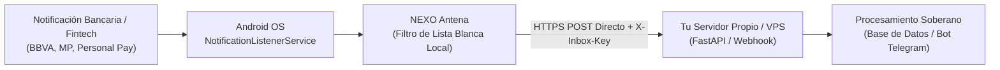

# NEXO Antena (Sovereign Notification Relay)

> **Antena Frugal, Soberana y Punto a Punto (P2P) para la Captura y Despacho de Notificaciones en Android hacia Servidores Propios.**

[](LICENSE)
[]()
[-success.svg)]()

---

## 🧭 Manifiesto de Soberanía y Privacidad Radical

En el ecosistema móvil contemporáneo, casi todas las utilidades de reenvío de notificaciones o automatizaciones bancarias obligan al usuario a enrutar su tráfico a través de servidores en la nube de terceros, Firebase, Pushover o servicios propietarios cerrados. Esto expone datos financieros sensibles (montos, comercios, saldos, tarjetas) a la minería de datos y filtraciones.

**NEXO Antena fue concebido bajo el principio de Soberanía Tecnológica:**

1. **Cero Servidores Intermediarios (P2P Puro):** La antena se comunica directa y exclusivamente con la URL de webhook que tú configures (por ejemplo, tu propio servidor VPS doméstico o en la nube).
2. **Cero Telemetría y Cero Analíticas:** No incluye Google Analytics, Firebase, Crashlytics, Mixpanel ni ningún SDK de rastreo de terceros.
3. **Cero Retención Externa:** Las notificaciones se capturan en memoria local, se empaquetan en un JSON estándar y se transmiten por HTTPS directo con tu propia clave de autenticación (`X-Inbox-Key`).
4. **Filtro Estricto en Origen:** La antena solo procesa y despacha notificaciones de las aplicaciones que marques explícitamente en la lista blanca de la interfaz.

---

## ⚖️ Declaración Ética, Transparencia y Cláusula Anti-Stalkerware

> [!WARNING]
> **ESTRICTAMENTE PROHIBIDO EL USO COMO STALKERWARE O HERRAMIENTA DE ESPIONAJE.**

Este software ha sido diseñado exclusivamente para la productividad y autogestión personal en dispositivos de propiedad legítima del usuario o con el consentimiento previo, explícito e informado de este.

1. **Notificación de Estado Visible Obligatoria:**
   Por diseño de ingeniería y compromiso ético, NEXO Antena **no puede ejecutarse de manera oculta ni invisible**. Mantiene una notificación persistente en el panel de estado del sistema Android mientras el servicio de escucha está activo, informando claramente al portador del dispositivo que la escucha está habilitada.
2. **Responsabilidad Legal del Operador:**
   La instalación encubierta o no consentida de este software en dispositivos ajenos para vigilar, espiar o interceptar comunicaciones privadas constituye un **delito penal grave** sancionado por las leyes de la República Argentina (Código Penal, Arts. 153 y 153 bis; Ley 25.326 de Protección de Datos Personales) y marcos jurídicos internacionales (GDPR, Wiretap Act, Convenio de Budapest).
3. **Exención de Responsabilidad:**
   Los autores y mantenedores del proyecto deslindan toda responsabilidad civil o penal derivada del uso ilícito, malicioso o no autorizado que terceros hagan de este código fuente o sus binarios. Consulta el texto íntegro en [LICENSE](LICENSE).

---

## 📡 Cómo Funciona la Antena



1. **Escucha Somática:** Se ancla al servicio oficial `NotificationListenerService` de Android.
2. **Filtro Local:** Compara el `packageName` emisor contra la selección configurada por el usuario.
3. **Despacho Inmediato:** Envía una petición `POST` al endpoint configurado con un encabezado seguro de autenticación.

---

## 📋 Contrato del Payload (JSON)

Cada notificación filtrada se envía como un objeto JSON con la siguiente estructura universal:

```json
{
  "package_name": "com.banco.ejemplo",
  "title": "Compra aprobada",
  "text": "Por ARS 1.500,00 en COMERCIO EJEMPLO con tarjeta terminada en 1234",
  "timestamp": 1729092400000,
  "extras": {
    "android.title": "Compra aprobada",
    "android.text": "Por ARS 1.500,00 en COMERCIO EJEMPLO con tarjeta terminada en 1234"
  }
}
```

### Cabeceras HTTP Enviadas:
- `Content-Type: application/json`
- `X-Inbox-Key: <TU_CLAVE_CONFIGURADA>`
- `User-Agent: NexoAntena/1.0.0 (Android; Sovereign-P2P)`

---

## ⚙️ Configuración en la Aplicación

1. **URL del Webhook:** La dirección completa de tu endpoint (ej: `https://tu-vps.com/api/inbox/webhook`).
2. **API Key (`X-Inbox-Key`):** Clave secreta que viaja en la cabecera para autorizar la petición en tu servidor.
3. **Permiso de Acceso a Notificaciones:** Android solicitará que actives el permiso especial en *Ajustes > Notificaciones > Acceso a notificaciones*.
4. **Selección de Apps:** Marca únicamente las aplicaciones que deseas reenviar (BBVA, Mercado Pago, Personal Pay, etc.).

---

## 🛠️ Compilación y Desarrollo

Requisitos:
- Android Studio / Android SDK (API 26+)
- Gradle 8.x + JDK 17

```bash
# Clonar el repositorio
git clone https://github.com/ldlmarcelo/nexo-antena.git
cd nexo-antena

# Compilar APK Debug
./gradlew assembleDebug

# Compilar APK Release
./gradlew assembleRelease
```

---

## 📄 Licencia

Este proyecto está bajo la Licencia **MIT** con la **Cláusula Adicional de Uso Ético, Privacidad y Anti-Spyware**. Consulta [LICENSE](LICENSE) para más detalles.
