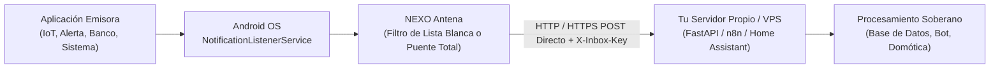

# NEXO Antena (Sovereign Android Notification Relay)

> **Relé Universal, Frugal y Punto a Punto (P2P) para la Captura y Despacho de Eventos de Notificación en Android hacia Servidores Propios.**

[](LICENSE)
[]()
[-success.svg)]()

---

## 🧭 Manifiesto de Soberanía e Infraestructura P2P

En el ecosistema móvil contemporáneo, casi todas las utilidades de reenvío de notificaciones o automatizaciones móviles obligan al usuario a enrutar su tráfico a través de servidores en la nube de terceros, Firebase, Pushover o servicios comerciales cerrados. Esto somete datos sensibles de eventos a la intermediación forzada, la minería de perfiles y la dependencia de infraestructuras ajenas.

**NEXO Antena fue concebido como un componente de infraestructura móvil soberana:**

1. **Cero Servidores Intermediarios (P2P Puro):** La antena se comunica directa y exclusivamente con la URL de webhook que tú configures (por ejemplo, tu propio servidor doméstico, VPS o endpoint local).
2. **Cero Telemetría y Cero Analíticas:** No incluye Google Analytics, Firebase, Crashlytics, Mixpanel ni ningún SDK de rastreo de terceros.
3. **Cero Retención Externa:** Las notificaciones se capturan en memoria local, se empaquetan en un JSON estándar y se transmiten por HTTP/HTTPS directo con tu propia clave de autenticación (`X-Inbox-Key`).
4. **Filtrado Dinámico en Origen:** Puedes elegir reenviar todas las notificaciones (Modo Puente Total) o seleccionar dinámicamente qué aplicaciones instaladas en tu dispositivo deseas monitorear mediante una lista blanca local.

---

## 💡 Casos de Uso Universales

NEXO Antena no está acoplada a ninguna aplicación en particular; actúa como un sensor de eventos en tiempo real para cualquier arquitectura:

- **Domótica e Internet de las Cosas (IoT):** Disparar automatizaciones en Home Assistant o Node-RED ante eventos de timbres inteligentes, sensores de presencia, alarmas o alertas del hogar.
- **Monitoreo de Servidores y DevOps:** Reenviar alertas de sistemas (Docker, SSH, UptimeRobot, monitores de salud) hacia paneles centralizados o canales privados.
- **Automatizaciones y Pipelines de Datos:** Inyectar eventos móviles como disparadores (*triggers*) en motores como n8n, FastAPI, WebSockets o scripts autónomos de Python.
- **Finanzas Personales y Contabilidad:** Capturar al instante las notificaciones de compras y transferencias emitidas por bancos y billeteras electrónicas para supervisión y registro en sistemas contables personales sin intervención manual.
- **Logística y Mensajería:** Monitorear estados de envíos, tracking de paquetes o alertas críticas de trabajo.

---

## ⚖️ Declaración Ética, Transparencia y Cláusula Anti-Stalkerware

> [!WARNING]
> **ESTRICTAMENTE PROHIBIDO EL USO COMO STALKERWARE O HERRAMIENTA DE ESPIONAJE.**

Este software ha sido diseñado exclusivamente para la productividad y autogestión personal en dispositivos de propiedad legítima del usuario o con el consentimiento previo, explícito e informado de este.

1. **Notificación de Estado Visible Obligatoria:**
   Por diseño de ingeniería y compromiso ético, NEXO Antena **no puede ejecutarse de manera oculta ni invisible**. Mantiene una notificación persistente en el panel de estado del sistema Android mientras el servicio de escucha está activo, informando claramente al portador del dispositivo que la escucha está habilitada.
2. **Responsabilidad Legal del Operador:**
   La instalación encubierta o no consentida de este software en dispositivos ajenos para vigilar, espiar o interceptar comunicaciones privadas constituye un **delito penal grave** sancionado por las leyes de la República Argentina (Código Penal, Arts. 153 y 153 bis; Ley 25.326 de Protección de Datos Personales) y marcos jurídicos internacionales (GDPR, Wiretap Act, Convenio de Budapest sobre Ciberdelincuencia).
3. **Exención de Responsabilidad:**
   Los autores y mantenedores del proyecto deslindan toda responsabilidad civil o penal derivada del uso ilícito, malicioso o no autorizado que terceros hagan de este código fuente o sus binarios. Consulta el texto íntegro en [LICENSE](LICENSE).

---

## 📡 Arquitectura y Flujo de Operación



1. **Escucha Somática:** Se ancla al servicio oficial `NotificationListenerService` de Android en memoria de ejecución.
2. **Filtro Local Configurable:** Compara el `packageName` emisor contra la selección configurada por el usuario (o permite paso total).
3. **Despacho Inmediato Asíncrono:** Envía una petición `POST` al endpoint configurado con cabeceras de autenticación y carga útil limpia.

---

## 📋 Contrato del Payload Universal (JSON)

Cada notificación despachada se envía como un objeto JSON agnóstico con la siguiente estructura:

```json
{
  "package_name": "com.ejemplo.app",
  "title": "Alerta de Evento",
  "text": "Descripción o contenido de la notificación emitida",
  "timestamp": 1729092400000,
  "extras": {
    "android.title": "Alerta de Evento",
    "android.text": "Descripción o contenido de la notificación emitida"
  }
}
```

### Cabeceras HTTP Enviadas:
- `Content-Type: application/json`
- `X-Inbox-Key: <TU_CLAVE_CONFIGURADA>`
- `User-Agent: NexoAntena/1.0.0 (Android; Sovereign-P2P)`

---

## ⚙️ Configuración en la Aplicación

1. **URL del Webhook:** La dirección completa de tu endpoint receptor (ej: `https://tu-servidor.com/api/inbox/webhook`).
2. **Clave Secreta (`X-Inbox-Key`):** Token opcional de seguridad que viaja en la cabecera para autorizar la petición en tu servidor.
3. **Permiso de Acceso a Notificaciones:** Android solicitará que actives el permiso especial en *Ajustes > Notificaciones > Acceso a notificaciones*.
4. **Modo de Operación:**
   - **Modo Puente Total:** Reenvía cualquier notificación emitida por el sistema.
   - **Modo Lista Blanca:** Abre un selector dinámico de aplicaciones instaladas en tu teléfono para elegir exactamente cuáles escuchar, con soporte adicional para paquetes manuales.
5. **Botón de Prueba (Ping):** Permite verificar la conectividad de red y la autenticación contra tu servidor antes de dejar el servicio activo.

---

## 🛠️ Compilación y Desarrollo

Requisitos:
- Android Studio / Android SDK (API 26+)
- JDK 17
- Gradle 9.x (incluido con `./gradlew`)

```bash
# Clonar el repositorio
git clone https://github.com/ldlmarcelo/nexo-antena.git
cd nexo-antena

# Compilar APK Debug
./gradlew assembleDebug

# Compilar APK Release
./gradlew assembleRelease
```

El binario compilado se genera en `app/build/outputs/apk/debug/app-debug.apk`.

---

## ⚖️ Descargo de Marcas Registradas (Trademark Disclaimer)

Todas las marcas comerciales, nombres de productos, logotipos y nombres de aplicaciones de terceros que pudieran ser mencionados en ejemplos, documentación o por usuarios son propiedad exclusiva de sus respectivos titulares. Su referencia es meramente descriptiva y a los fines de ilustrar la compatibilidad técnica del software, sin implicar afiliación, patrocinio ni respaldo oficial alguno hacia o desde este proyecto.

---

## 📄 Licencia

Este proyecto está bajo la Licencia **MIT** con la **Cláusula Adicional de Uso Ético, Privacidad y Anti-Spyware**. Consulta [LICENSE](LICENSE) para más detalles.
